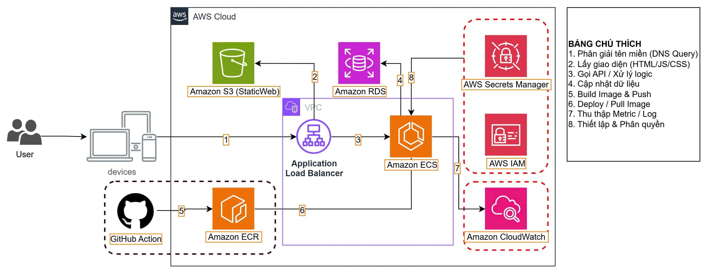
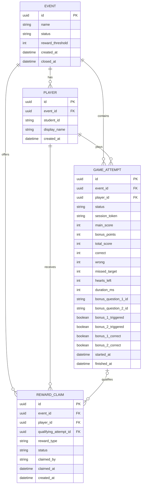

# Match & Catch — Tài liệu yêu cầu và thiết kế MVP

**Thời gian triển khai:** 22–23/09/2026 · **Deadline:** 24/09/2026  
**Nền tảng:** Web trên điện thoại, truy cập bằng mã QR

---

## 0. Quyết định kỹ thuật đã chốt

| Hạng mục | Quyết định |
| --- | --- |
| Frontend | React + TypeScript + Vite — tối ưu cho mobile web |
| Backend | Python (FastAPI hoặc Flask) |
| Database | MySQL (Amazon RDS) |
| Deploy | AWS: S3 StaticWeb (FE), ECS + ALB trong VPC (BE), RDS (DB), ECR + GitHub Actions (CI/CD) |
| Auth người chơi | Backend trả `session_token` sau `/game/start`; FE lưu localStorage, gửi kèm mọi request. Nếu người chơi thoát giữa chừng, lượt cũ tự động `abandoned`; quét QR lại sẽ tạo lượt mới hoàn toàn. |
| Auth BTC | Một tài khoản admin duy nhất, mật khẩu cố định trong `.env` |
| REWARD_THRESHOLD | **12 điểm** (cố định trong `.env`, không cần UI chỉnh) |
| Thẻ bay | 1 thẻ tại một thời điểm, bay từ phải → trái hoặc trái → phải ngẫu nhiên, tốc độ ~3 giây/lượt |

---

## 1. Mục tiêu và phạm vi

Người chơi nhập họ tên và mã số sinh viên (MSSV), nhận diện các dịch vụ AWS và Google Cloud qua thẻ tên di chuyển, trả lời câu bonus, xem điểm và bảng xếp hạng. Ban tổ chức (BTC) tra cứu MSSV, kiểm tra điều kiện và xác nhận trao quà trực tiếp.

**Chức năng cần có:** đăng ký, hai vòng chơi, bonus, lưu lượt chơi, Top 10, màn kết quả, thông tin nhận quà và trang BTC có đăng nhập.

**Không triển khai:** multiplayer, ứng dụng native, SSO trường, CMS câu hỏi, power-up, thành tích, voucher/mã thưởng tự động, dashboard nâng cao, UI chỉnh threshold. Game chỉ tối ưu cho điện thoại; trang BTC có thể dùng trên máy tính.

---

## 2. Luật chơi

| Nội dung | Quy tắc |
| --- | --- |
| Bắt đầu | Quét QR → nhập họ tên, MSSV → nhấn **Play Game**. |
| Vòng chơi | Vòng 1: AWS; Vòng 2: Google Cloud. |
| Thẻ Vòng 1 | 14 thẻ AWS (mục tiêu) + 6 thẻ Google Cloud (nhiễu) = **20 thẻ**. |
| Thẻ Vòng 2 | 6 thẻ Google Cloud (mục tiêu) + 14 thẻ AWS (nhiễu) = **20 thẻ**. |
| Hiển thị thẻ | **1 thẻ tại một thời điểm**, bay từ phải → trái hoặc trái → phải (ngẫu nhiên mỗi thẻ), tốc độ ~3 giây qua màn hình. |
| Cơ chế nhận diện | Logo nhà cung cấp mục tiêu hiển thị rõ; người chơi chạm vào thẻ đúng nhà cung cấp đó. |
| Chọn đúng | **+1 điểm**, tăng chuỗi đúng liên tiếp thêm 1. |
| Chọn sai | **0 điểm**, mất 1 mạng, chuỗi đúng về 0. |
| Bỏ lỡ thẻ mục tiêu | **0 điểm**, **không mất mạng**, chuỗi đúng về 0. |
| Bỏ lỡ thẻ nhiễu | **0 điểm**, không mất mạng, không ảnh hưởng chuỗi đúng. |
| Mạng sống | Bắt đầu với **3 mạng**, dùng chung cho cả hai vòng. **Chỉ mất mạng khi chọn sai.** |
| Kết thúc | Hết 3 mạng hoặc xử lý hết tất cả thẻ của hai vòng. |
| Giới hạn lượt | Mỗi MSSV chỉ được chơi tối đa **3 lượt** (không tính lượt `abandoned`). Hết 3 lượt, nút Play Game bị khoá. |
| Điểm game chính | Tối đa **20 điểm** (20 thẻ mục tiêu trên 2 vòng). |

Mỗi thẻ chỉ được xử lý một lần; thẻ đã chọn hoặc đã bay khỏi màn hình không được tính lại. Chuỗi đúng được giữ khi chuyển vòng. Khi bonus xuất hiện, game chính tạm dừng.

---

## 3. Câu hỏi bonus

Khi người chơi **chọn đúng 5 thẻ mục tiêu liên tiếp** (theo bộ đếm chuỗi bonus), hệ thống tạm dừng game và hiển thị **một câu hỏi bonus** về chức năng của dịch vụ AWS phổ biến. Người chơi có thể **chọn nhiều đáp án** rồi nhấn **Xác nhận**.

| Nội dung | Quy tắc |
| --- | --- |
| Số lần | Tối đa **2 lần/lượt chơi** — mỗi lần đếm đủ 5 chuỗi bonus liên tiếp. |
| Câu hỏi | Lấy ngẫu nhiên từ ngân hàng 6–10 câu; **2 câu trong cùng lượt không trùng nhau**. |
| Đáp án | Có 2–4 lựa chọn; có thể có nhiều đáp án đúng. |
| Đúng | Chọn **đầy đủ và chỉ** các đáp án đúng: **+3 điểm**. |
| Sai / bỏ qua | **0 điểm**, không trừ mạng. |
| Tiếp tục | Đóng bonus, **streak bonus reset về 0**, streak hiển thị giữ nguyên; tiếp tục game chính. |
| Điểm tối đa | **26 điểm = 20 điểm chính + 3 + 3 điểm bonus**. |

**Hai bộ đếm chuỗi độc lập:**

| Bộ đếm | Mục đích | Reset khi |
| --- | --- | --- |
| **Streak hiển thị** | Hiển thị cho người chơi, dùng cho UI combo | Chọn sai hoặc bỏ lỡ thẻ mục tiêu |
| **Streak bonus** | Đếm ngầm để kích hoạt câu bonus | Chọn sai, bỏ lỡ thẻ mục tiêu, **hoặc sau khi bonus kết thúc** |

Khi chọn sai hoặc bỏ lỡ thẻ mục tiêu: **cả hai bộ đếm đều về 0**.  
Khi bonus kết thúc (đúng hoặc sai): chỉ streak bonus về 0, streak hiển thị **không đổi**.  
Chuỗi tính **xuyên suốt cả hai vòng**, không reset khi chuyển vòng.

**Ví dụ:** *Amazon S3 có thể dùng để làm gì?* Đáp án đúng: lưu trữ/truy xuất object; lưu trữ nội dung tĩnh của website. Đáp án nhiễu: chạy máy ảo; quản lý cơ sở dữ liệu quan hệ.

Ngân hàng câu hỏi và đáp án đúng nằm ở backend; frontend chỉ nhận nội dung và các lựa chọn cần hiển thị.

---

## 4. Luồng người dùng và trao quà

### 4.1. Người chơi

1. Quét QR → nhập họ tên và MSSV → nhấn **Play Game**.
2. Backend trả về `session_token`; frontend lưu vào localStorage. Nếu localStorage đã có token từ lượt cũ, backend đánh lượt đó là `abandoned` và tạo lượt mới.
3. Chơi Vòng 1 (AWS) → Vòng 2 (Google Cloud); bonus xuất hiện khi đủ điều kiện.
4. Kết thúc → hệ thống lưu kết quả và hiển thị **điểm chính, điểm bonus, tổng điểm, mạng còn lại và Top 10**.
5. Nhấn **Thông tin nhận quà** để hiển thị họ tên, MSSV, điểm cao nhất và trạng thái đủ điều kiện/đã nhận quà; đưa màn hình cho BTC đối chiếu.

### 4.2. Ban tổ chức

1. Truy cập trang BTC, đăng nhập bằng tài khoản admin.
2. Nhập **MSSV** để tra cứu: xem họ tên, các lượt chơi, lượt có điểm cao nhất, loại quà đủ điều kiện và tình trạng nhận quà.
3. Đối chiếu sinh viên ngoài thực tế rồi nhấn **Xác nhận đã trao quà**.
4. Hệ thống lưu người xác nhận và thời điểm; quà đã xác nhận không thể nhận lần thứ hai.

Thông tin trên điện thoại người chơi không thay thế việc BTC kiểm tra dữ liệu trực tiếp. **MSSV không xuất hiện trên bảng xếp hạng công khai.**

### 4.3. Điều kiện và xếp hạng

| Nội dung | Quy tắc |
| --- | --- |
| Quà đạt ngưỡng | Điểm cao nhất của MSSV ≥ **12 điểm** (`REWARD_THRESHOLD = 12`, cố định trong `.env`). |
| Quà Top 3 | Xác định theo bảng xếp hạng sau khi đóng sự kiện; quản lý riêng với quà đạt ngưỡng. |
| Nhận đồng thời | Một người **có thể** nhận cả quà đạt ngưỡng lẫn quà Top 3 nếu đủ điều kiện cả hai. |
| Lượt chơi | Một MSSV có thể chơi lại; tối đa **3 lượt/MSSV**; chỉ **lượt tốt nhất** được dùng để xếp hạng. |
| Xếp hạng | Tổng điểm giảm dần → mạng còn lại giảm dần → thời gian chơi tăng dần → thời điểm hoàn thành sớm hơn. |
| Chống nhận trùng | Mỗi MSSV chỉ được xác nhận nhận **một lần cho mỗi loại quà** trong sự kiện. |

---

## 5. Kiến trúc hệ thống

### 5.1. Sơ đồ kiến trúc AWS



**Bảng chú thích luồng:**

| # | Luồng |
| --- | --- |
| 1 | Phân giải tên miền (DNS Query) |
| 2 | Lấy giao diện (HTML/JS/CSS) từ S3 StaticWeb |
| 3 | Gọi API / Xử lý logic qua Application Load Balancer → ECS |
| 4 | Cập nhật dữ liệu giữa ECS ↔ RDS |
| 5 | Build Image & Push từ GitHub Actions → ECR |
| 6 | Deploy / Pull Image từ ECR → ECS |
| 7 | Thu thập Metric / Log từ ECS → CloudWatch |
| 8 | Thiết lập & Phân quyền qua Secrets Manager → RDS |

### 5.2. Phân công thành phần

| Thành phần | Công nghệ | Vai trò |
| --- | --- | --- |
| Frontend | React + TypeScript + Vite | Game UI, hoạt ảnh thẻ, màn bonus, kết quả, trang BTC |
| Static Hosting | Amazon S3 (StaticWeb) | Phục vụ file frontend tĩnh (HTML/JS/CSS) |
| Load Balancer | Application Load Balancer (ALB) | Điều hướng traffic HTTPS vào ECS, nằm trong VPC |
| Backend | Python (FastAPI/Flask) trên Amazon ECS | Logic game, tính điểm, bảng xếp hạng, xác nhận quà |
| Database | MySQL trên Amazon RDS | Lưu sinh viên, lượt chơi, sự kiện, trạng thái quà |
| Container Registry | Amazon ECR | Lưu trữ Docker image của backend |
| CI/CD | GitHub Actions | Build image → push ECR → deploy lên ECS |
| Bí mật | AWS Secrets Manager | DB password, admin password, secret key |
| Phân quyền | AWS IAM | Role & policy cho ECS task, ECR pull, RDS access |
| Giám sát | Amazon CloudWatch | Log, metric, alert từ ECS |

### 5.3. Trạng thái hệ thống

```text
Attempt: created → in_progress → submitted | abandoned
Card:    spawned → flying → clicked | missed → processed
Bonus:   locked → available → answered
Reward:  eligible → claimed
```

### 5.4. Quy tắc tính điểm (backend kiểm tra)

```
main_score    = số thẻ mục tiêu chọn đúng
bonus_points  ∈ {0, 3, 6}   # 0, 1 hoặc 2 câu bonus đúng
total_score   = main_score + bonus_points        (0 ≤ total_score ≤ 26)
hearts_left   = max(0, 3 − wrong)               # chỉ trừ mạng khi chọn sai
```

Backend **không tin** điểm tổng do client tự gửi. Backend cấp trước danh sách thẻ theo lượt chơi và kiểm tra nhật ký thao tác khi nhận submit. Mỗi lượt chỉ ghi kết quả một lần; mỗi thẻ chỉ tính một lần.

---

## 6. ERD



**Ràng buộc dữ liệu:**

- `PLAYER`: unique `(event_id, student_id)`.
- `GAME_ATTEMPT`: `session_token` unique, dùng để xác thực người chơi trong phiên.
- `REWARD_CLAIM`: unique `(event_id, player_id, reward_type)`; `reward_type ∈ {threshold, top3}`.
- Điểm và mạng không âm; `bonus_points ∈ {0, 3, 6}`; khóa ngoại phải thuộc đúng người chơi/sự kiện.
- `hearts_left = max(0, 3 − wrong)` — chỉ trừ mạng khi chọn sai; `missed_target` lưu để thống kê, không ảnh hưởng mạng.
- `bonus_1_triggered` / `bonus_2_triggered`: đánh dấu lần bonus đã kích hoạt; backend dùng để giới hạn tối đa 2 lần/lượt.
- Xác nhận quà bằng transaction: chỉ chuyển `eligible → claimed` khi trạng thái hiện tại vẫn là `eligible`.

---

## 7. API tối thiểu

| Method | Endpoint | Chức năng |
| --- | --- | --- |
| POST | `/api/players` | Đăng ký hoặc tìm người chơi theo MSSV trong sự kiện. |
| POST | `/api/game/start` | Tạo lượt chơi, trả `session_token`, bộ thẻ đã xáo và cấu hình hiển thị. |
| POST | `/api/game/submit` | Nhận nhật ký thao tác, kiểm tra và lưu kết quả một lần (idempotent). |
| GET | `/api/game/attempts/:id` | Lấy kết quả lượt chơi — yêu cầu `session_token` hợp lệ. |
| GET | `/api/leaderboard` | Lấy Top 10, không trả MSSV. |
| GET | `/api/rewards/me` | Lấy điều kiện và trạng thái quà của người chơi — yêu cầu `session_token`. |
| POST | `/api/admin/login` | Đăng nhập BTC, trả admin token. |
| GET | `/api/admin/players?student_id=...` | Tra cứu MSSV, lượt chơi và trạng thái quà — yêu cầu admin token. |
| POST | `/api/admin/reward-claims/:id/claim` | Xác nhận đã trao quà, chống thao tác trùng — yêu cầu admin token. |
| POST | `/api/admin/event/close` | Đóng sự kiện và chốt bảng xếp hạng Top 3 — yêu cầu admin token. |

**Xác thực:**
- Người chơi: gửi `session_token` trong header `Authorization: Bearer <token>` hoặc body.
- BTC: đăng nhập một lần, nhận admin token, gửi kèm mọi request admin.
- Submit lặp do lỗi mạng: backend trả kết quả đã lưu thay vì cộng điểm lần hai (idempotent theo `attempt_id`).

---

## 8. Giao diện và cấu trúc dự án

### 8.1. Các màn hình

| Màn hình | Thành phần chính |
| --- | --- |
| Home | Form họ tên + MSSV, nút **Play Game**. |
| Game | Logo nhà cung cấp mục tiêu, thẻ bay (1 thẻ, hai chiều ngẫu nhiên, ~3s), điểm, 3 tim, tiến độ vòng. |
| Bonus | Icon dịch vụ AWS, câu hỏi, checkbox nhiều đáp án, nút **Xác nhận**. |
| Result | Điểm chính + bonus + tổng, mạng còn lại, Top 10, nút **Thông tin nhận quà**. |
| Reward Info | Họ tên, MSSV, điểm cao nhất, trạng thái từng loại quà — hiển thị ngay sau game kết thúc. |
| Admin Login | Form username + password. |
| Admin Dashboard | Ô tìm MSSV, bảng lượt chơi, trạng thái quà, nút **Xác nhận trao quà**, nút **Đóng sự kiện**. |

### 8.2. Cấu trúc dự án

```text
match-and-catch/
├── frontend/
│   ├── public/assets/          # logo AWS, Google Cloud, icon dịch vụ
│   └── src/
│       ├── pages/              # Home, Game, Bonus, Result, RewardInfo, Admin
│       ├── components/         # Card, HeartBar, ScoreBoard, Leaderboard
│       ├── game/               # logic thẻ bay, vòng chơi, chuỗi đúng
│       └── api/                # wrapper gọi backend
├── backend/
│   ├── app/
│   │   ├── routes/             # players, game, leaderboard, rewards, admin
│   │   ├── models/             # ORM: Event, Player, GameAttempt, RewardClaim
│   │   ├── services/           # game logic, scoring, leaderboard, reward check
│   │   └── db/                 # MySQL connection, migrations
│   ├── data/
│   │   ├── cards.json          # danh sách thẻ AWS + Google Cloud
│   │   └── bonus_questions.json # ngân hàng 6–10 câu bonus
│   ├── .env.example
│   ├── Dockerfile              # build image → push ECR → deploy ECS
│   └── requirements.txt
├── .github/workflows/          # CI/CD: build → ECR → ECS deploy
└── README.md
```

---

## 9. Kiểm thử nghiệm thu

| ID | Kịch bản | Kết quả mong đợi |
| --- | --- | --- |
| T01 | Chọn đúng, sai, bỏ lỡ thẻ mục tiêu/nhiễu | Chọn sai → mất mạng + cả 2 streak về 0; bỏ lỡ mục tiêu → cả 2 streak về 0, không mất mạng; bỏ lỡ nhiễu → không ảnh hưởng. |
| T02 | Đúng 5 thẻ mục tiêu liên tiếp (lần 1) | Bonus lần 1 xuất hiện, game tạm dừng; streak bonus về 0 sau khi đóng; streak hiển thị giữ nguyên. |
| T03 | Sau bonus lần 1, tiếp tục đúng thêm 5 liên tiếp | Bonus lần 2 kích hoạt; sau đó không còn bonus nào nữa dù tiếp tục đúng. |
| T04 | Chọn đủ / thiếu / thừa đáp án bonus | Chỉ chọn chính xác toàn bộ mới +3; sai hoặc bỏ qua không trừ mạng. |
| T05 | Chạm liên tục một thẻ | Không tính điểm hay trừ mạng hai lần. |
| T06 | Hết mạng hoặc hết hai vòng | Game kết thúc, lưu đúng một kết quả. |
| T07 | Sửa điểm, submit lặp | Backend kiểm tra nhật ký, không ghi điểm trùng. |
| T08 | Cùng MSSV chơi lại; nhiều người bằng điểm | Chọn lượt tốt nhất; xếp hạng theo thứ tự quy tắc. |
| T08b | MSSV đã chơi đủ 3 lượt (không tính abandoned) | Nút Play Game bị khoá, không tạo được lượt mới. |
| T09 | Xem Top 10 | Không lộ MSSV hay thông tin cá nhân. |
| T10 | BTC tìm MSSV, xác nhận quà hai lần | Chỉ lần đầu thành công; lần hai báo đã nhận. |
| T11 | Hai BTC xác nhận cùng lúc | Chỉ một transaction thành công (race condition). |
| T12 | Điểm cao nhất < 12 | Không đủ điều kiện nhận quà ngưỡng. |
| T13 | Điểm cao nhất ≥ 12 | Đủ điều kiện, BTC xác nhận được. |
| T14 | Người vừa đạt ngưỡng vừa Top 3 | Được nhận cả hai loại quà. |
| T15 | Mở game bằng QR trên điện thoại thật | Không tràn bố cục, thẻ dễ chạm, kết quả được lưu. |
| T16 | Thẻ bay từ hai hướng ngẫu nhiên | Người chơi nhận diện và chạm đúng ở cả hai hướng. |
| T17 | Streak xuyên vòng — đúng 3 thẻ cuối Vòng 1, đúng 2 thẻ đầu Vòng 2 | Bonus kích hoạt ở thẻ thứ 2 của Vòng 2 (đủ chuỗi 5 xuyên vòng). |
| T18 | Streak bonus reset sau bonus, streak hiển thị không đổi | Sau bonus kết thúc: streak hiển thị = giá trị trước bonus; streak bonus = 0. |
| T19 | Người chơi thoát giữa chừng rồi quét QR lại | Lượt cũ chuyển sang `abandoned`; lượt mới được tạo, bắt đầu từ đầu. |

---

## 10. Kế hoạch triển khai 2 ngày

| Thời gian | Công việc |
| --- | --- |
| **22/09 – Sáng** | Chốt danh sách thẻ (`cards.json`) và câu bonus (`bonus_questions.json`); tạo project, kết nối RDS, migration DB; hoàn thành `/api/players` và `/api/game/start` (trả `session_token` + bộ thẻ). |
| **22/09 – Chiều/tối** | Xây game frontend: thẻ bay 2 chiều (~3s), xử lý chạm, điểm/mạng/chuỗi, màn bonus; kiểm thử T01–T04 trên trình duyệt. |
| **23/09 – Sáng** | Hoàn thành `/api/game/submit` (idempotent, kiểm tra nhật ký); tích hợp Top 10, màn kết quả, Reward Info; đăng nhập và tra cứu BTC (T09, T10). |
| **23/09 – Chiều/tối** | Kiểm thử trên điện thoại thật (T15–T18); xử lý lỗi mạng; deploy HTTPS lên AWS (S3 StaticWeb + ECS + ALB); chạy toàn bộ bảng kiểm thử. |

**Khi thiếu thời gian, ưu tiên theo thứ tự:** đăng ký → chơi → lưu kết quả → BTC tra cứu → xác nhận trao quà. Giản lược nhạc nền, hiệu ứng trang trí và CI/CD pipeline (deploy tay trước, pipeline sau).

---

## 11. Biến môi trường cần cấu hình

```env
# Database
DB_HOST=<RDS endpoint>
DB_PORT=3306
DB_NAME=match_and_catch
DB_USER=<username>
DB_PASSWORD=<password>  # lưu trong AWS Secrets Manager

# Game config
REWARD_THRESHOLD=12
EVENT_ID=<uuid sự kiện hiện tại>

# Admin
ADMIN_USERNAME=btc_admin
ADMIN_PASSWORD=<password>  # lưu trong AWS Secrets Manager

# App
SECRET_KEY=<random string dùng ký token>
CORS_ORIGINS=<domain frontend>
```
